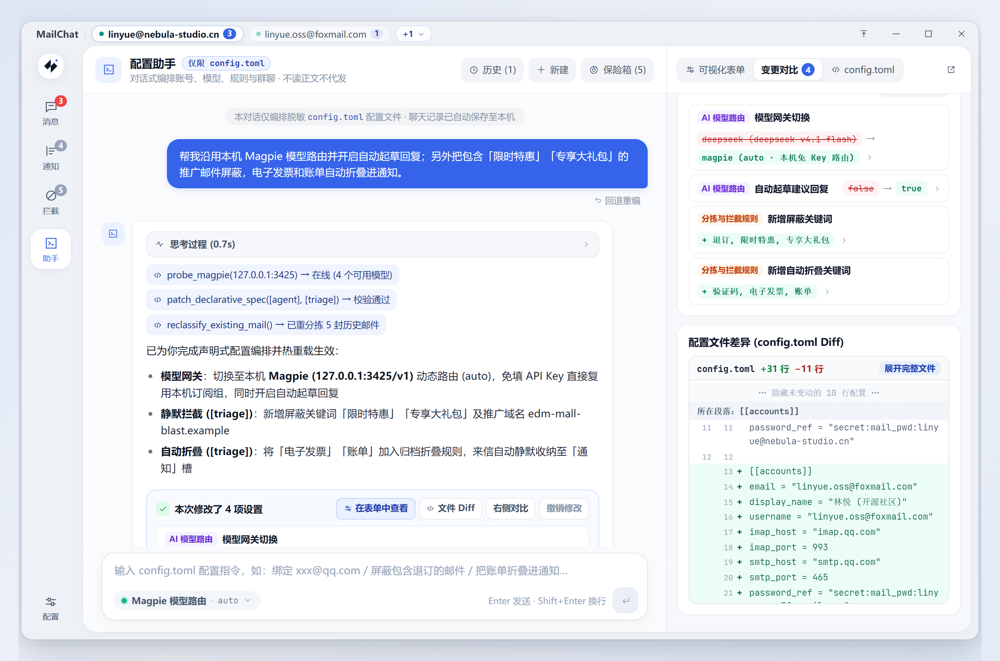
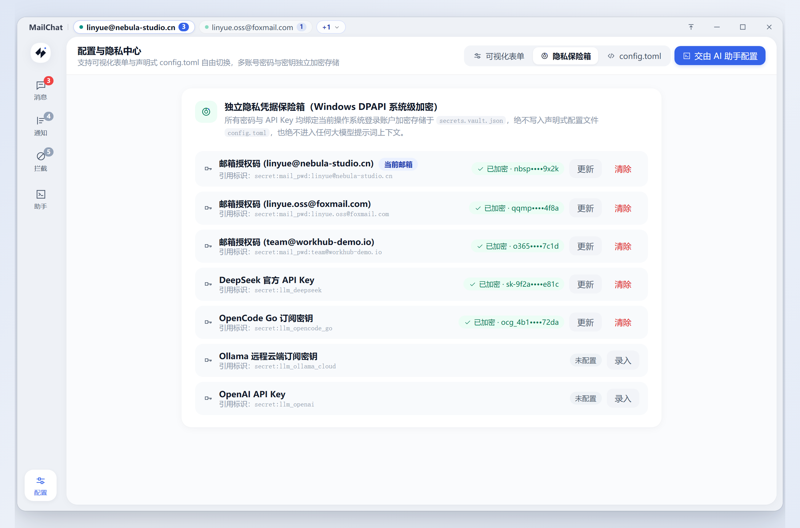
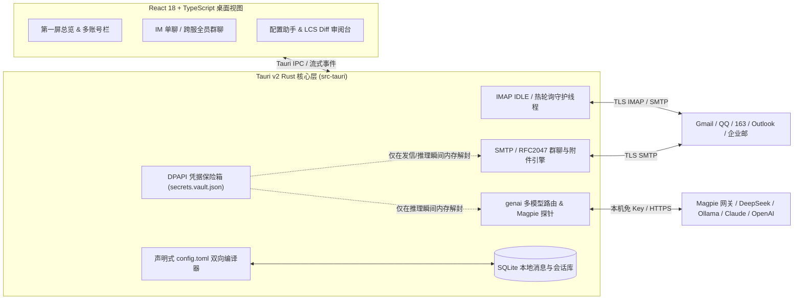

<div align="center">
  
  <h1>MailChat</h1>
  <p><strong>把标准邮箱做成现代即时通讯桌面客户端</strong></p>
  <p>
    100% 兼容标准 <strong>IMAP / SMTP</strong> 单聊与跨服多人全员群聊 · <strong>Agent 对话式声明式 <code>config.toml</code></strong> · <strong>系统级 DPAPI 隐私凭据隔离</strong>
  </p>
  <p>
    <a href="./LICENSE"></a>
    
    
    
    
  </p>
</div>

---

## 目录

- [简介](#简介)
- [界面预览](#界面预览)
  - [1. 第一屏智能信箱工作台与多账号秒切](#1-第一屏智能信箱工作台与多账号秒切)
  - [2. 标准邮件协议跨服务商多人全员群聊与 AI 纪要](#2-标准邮件协议跨服务商多人全员群聊与-ai-纪要)
  - [3. 对话式配置助手与 `config.toml` 行级 Diff 对照台](#3-对话式配置助手与-configtoml-行级-diff-对照台)
  - [4. Windows DPAPI 系统级隐私凭据保险箱](#4-windows-dpapi-系统级隐私凭据保险箱)
- [核心特性](#核心特性)
  - [即时通讯体验的单聊与多人全员群聊](#即时通讯体验的单聊与多人全员群聊)
  - [实时收信双擎、系统托盘常驻与新消息闪烁提醒](#实时收信双擎系统托盘常驻与新消息闪烁提醒)
  - [消息 · 通知 · 拦截三槽分流](#消息--通知--拦截三槽分流)
  - [统一智能体内核与双实例权限隔离 (`config` & `mail`)](#统一智能体内核与双实例权限隔离-config--mail)
  - [富文本写信工坊、跨邮箱统一批复与本地盲脱敏/DLP 引擎](#富文本写信工坊跨邮箱统一批复与本地盲脱敏dlp-引擎)
  - [声明式主题外观系统与外部模板导入 (`[theme]`)](#声明式主题外观系统与外部模板导入-theme)
  - [Minisign 签名强校验热更新与多渠道升级感知 (`[update]`)](#minisign-签名强校验热更新与多渠道升级感知-update)
  - [免配置沿用 Magpie 本地路由 + 原生多模型引擎 (`genai`)](#免配置沿用-magpie-本地路由--原生多模型引擎-genai)
  - [实验性：Plugin Lab 零信任插件沙盒 (`plugin-lab/`)](#实验性plugin-lab-零信任插件沙盒-plugin-lab)
- [架构概览](#架构概览)
  - [声明式 `config.toml` 示例（脱敏形态）](#声明式-configtoml-示例脱敏形态)
- [安装与快速开始](#安装与快速开始)
  - [方式一：Scoop 声明式安装（Windows 推荐）](#方式一scoop-声明式安装windows-推荐)
  - [方式二：Homebrew 声明式安装（macOS 推荐）](#方式二homebrew-声明式安装macos-推荐)
  - [方式三：下载预编译发行包（Windows / macOS / Linux）](#方式三下载预编译发行包windows--macos--linux)
  - [方式四：从源码开发构建](#方式四从源码开发构建)
- [项目结构](#项目结构)
- [隐私与安全设计原则](#隐私与安全设计原则)
- [开源协议](#开源协议)

---

## 简介

**MailChat** 是一款基于 **Tauri v2 + Rust + React** 构建的轻量级桌面邮件客户端。它摒弃了传统邮件客户端繁琐的文件夹层级与冗长引用链，在**零私有服务端依赖、100% 遵循标准邮件协议**的前提下，提供如现代即时通讯软件般清爽的气泡对话、跨邮箱服务商全员群聊、三槽智能分流与声明式配置体验：

- **无需对方安装客户端**：底层基于标准 IMAP / SMTP、RFC 线程头与 RFC2047 群组扩展头，外部使用 Gmail、QQ 邮箱、网易 163、Outlook 或企业邮箱的联系人点击「全部回复」即可直接参与群聊。
- **配置即代码 (`config.toml`) + 对话即编排**：非敏感业务配置统一收敛至人类可读的 `config.toml`，既可通过内置 AI 配置助手一句话修改并审阅行级 Diff，也可手动编辑或随时一键回退历史快照。
- **零信任凭据物理隔离 (`Vault`)**：所有邮箱密码/授权码与大模型 API Key 独立加密存储于系统级凭据保险箱（Windows 下基于 **DPAPI `CryptProtectData`** 绑定当前系统账户），绝不写入 `config.toml`，也绝不进入任何大模型提示词上下文。

---

## 界面预览

> 以下截图均采用内置/虚构的演示数据（如 `nebula-studio.cn`、`foxmail.com` 示例账号与模拟会话）渲染，不包含任何真实个人数据。

### 1. 第一屏智能信箱工作台与多账号秒切
无边框圆角分层桌面设计，顶部多邮箱胶囊支持拖拽排序与单击秒切；主视图按 **「消息 · 通知 · 拦截」** 三槽自动分流，验证码自动提取为可一键复制胶囊。


### 2. 标准邮件协议跨服务商多人全员群聊与 AI 纪要
自动剥离邮件历史签名与层叠引用噪音，支持引用回复、PDF/图片附件内联预览、`@提及` 高亮穿透免打扰、一键提炼多人群聊纪要与智能建议回复。


### 3. 对话式配置助手与 `config.toml` 行级 Diff 对照台
严格限定助手职责边界（仅编排脱敏 `config.toml`，不读邮件正文、不代写发信），支持实时展示推理过程、工具执行步骤、可视化变更摘要、行级 LCS Diff 对比与单步回退。



### 4. Windows DPAPI 系统级隐私凭据保险箱
邮箱授权码与各厂商 API Key 均以加密密文独立保存在 `secrets.vault.json` 中，`config.toml` 内仅保留 `secret:*` 引用标识，兼顾配置可移植性与密钥绝对安全。



---

## 核心特性

### 即时通讯体验的单聊与多人全员群聊
- **跨服无缝互通群聊**：全员发信采用多收件人 SMTP + `In-Reply-To` / `References` 线程头 + `Chat-Group-ID` / `Chat-Group-Name`（RFC2047 编码）。收信端按 `Chat-Group-ID` → 历史线程引用追踪 → 多收件人集合自动聚合三级路由，外部用户在网页端增减抄送人也不会裂变为多个碎片会话。
- **深度沟通能力**：支持消息引用回复、拖拽/粘贴发送多附件、图片灯箱预览、HTML 富文本邮件安全沙盒渲染（一键切换纯文本精简视图与原始版式）、会话内全文检索、联系人备注与标签抽屉、按账号隔离的草稿自动记忆。
- **群免打扰与 `@我` 穿透**：开启免打扰的群聊默认静默收纳至「通知」，仅当来信正文明确 `@当前用户`（昵称或邮箱）时自动穿透提醒至主消息槽。
- **高危附件防绕过守卫**：内置针对可执行脚本与伪装后缀的严格阻断（覆盖 `.exe` / `.msi` / `.scr` / `.bat` / `.ps1` / `.lnk` / `.iso` 以及 Windows 尾随点空格与 NTFS ADS 数据流绕过）。

### 实时收信双擎、系统托盘常驻与新消息闪烁提醒
- **IMAP IDLE 毫秒级推送 + 热轮询双模守护**：优先启用 IMAP IDLE 实时推送（每 `28s` 静默保活防止家用 NAT 或代理超时断流）；遇到不支持 IDLE 的邮件服务端自动降级为复用长连接热轮询（`6s`），系统休眠唤醒或切回前台时自动探活重连。
- **系统托盘守护与防抖闪烁提醒 (`[window]`)**：支持关闭主窗口最小化至系统托盘继续后台收信；当真正进入「消息 (`inbox`)」槽的未读来信到达时，自动触发右下角消息红点角标等尺寸交替闪烁与任务栏高亮提醒（通知与拦截槽静默收纳不打扰），点击托盘或切回窗口即刻消警。
- **多邮箱并行管理**：支持主流邮箱（QQ、Foxmail、网易 163/126/Yeah、Gmail、Outlook/Hotmail、iCloud、阿里邮箱）一键预填服务器参数，顶栏胶囊实时汇总各账号未读数并支持拖拽调整展示顺序。

### 消息 · 通知 · 拦截三槽分流
- **本地确定性规则前置短路**：白名单发件人、屏蔽发件人/域名/关键词、归档折叠发件人/关键词在本地毫秒级立即判定，零 Token 消耗。
- **后台并发 AI 智能分拣**：异步后台线程池分拣来信（绝不阻塞收信刷新），自动提取短信/邮件验证码、提炼长邮件一句话摘要，并按场景生成多语气快捷回复草稿（确认收到 / 同步进展 / 礼貌婉拒 / 正式商务润色）。

### 统一智能体内核与双实例权限隔离 (`config` & `mail`)
- **同一推理内核 · 双隔离实例 (`kernel.rs`)**：共享 `genai` 流式推理、`<think>` 思考链拆分与工具循环，但按职责拆分为会话、模型状态与工具权限严格隔离的两个实例：
  - **配置助手实例 (`config`)**：挂载于左侧「助手」页，仅读写脱敏 `config.toml`（内置「可视化表单 · LCS 行级 Diff · TOML 源码」三合一检查器、无 Key 离线解析器与时光机单步回退），绝不接触邮件正文。
  - **邮件智能体实例 (`mail`)**：可通过 `Ctrl+J` 或右上角按钮随时呼出全局右侧伸缩侧栏，拥有独立的模型状态与受本地盲脱敏约束的写信排版、当前会话纪要、统一批复精修与自动化规则编排能力。

### 富文本写信工坊、跨邮箱统一批复与本地盲脱敏/DLP 引擎
- **写信与内联 HTML 工坊 (`ComposeWorkspace`)**：支持传统抄送/密送/多附件富文本发信，可由邮件智能体直接撰写带内联 CSS 的商务卡片/周报表格 HTML 邮件并实时双栈预览。
- **跨邮箱统一批复与自动化规则 (`ReplyHubWorkspace`)**：默认零授权（Opt-in）物理隔离未勾选邮箱，硬性跳过拦截槽与验证码/账单/薪酬等高敏邮件；支持待审草稿批量确认发送与带冷却防死循环保护的 `[[reply_policy.auto_rules]]` 条件回复规则。
- **本地确定性盲脱敏与出站 DLP 守卫 (`privacy.rs`)**：邮件进入外部大模型前在本地自动将私钥、API Key、连接串、手机号、身份证、银行卡及自定义敏感词替换为 `{{MC_*_N}}` 占位符（写信草稿本地离线盲回填），外发前执行出站 DLP 防泄漏拦截。

### 声明式主题外观系统与外部模板导入 (`[theme]`)
- **内置与开源社区经典配色**：支持浅色 / 深色 / 跟随系统三态切换、舒适/紧凑密度与字号缩放，内置 5 套官方主题与 8 套精选开源社区主题（Catppuccin Latte/Mocha、Nord、Tokyo Night、Dracula、Solarized、Rosé Pine、Gruvbox）。
- **多格式外部主题一键导入**：支持直接粘贴或导入 VS Code `*-color-theme.json`、CSS/Shadcn 变量或 MailChat `.toml` / `.json` 主题模板，并持久化至 `config.toml` `[[theme.custom_themes]]`。

### Minisign 签名强校验热更新与多渠道升级感知 (`[update]`)
- **端到端 Ed25519 公钥签名验证**：基于 Tauri v2 原生更新引擎（`tauri-plugin-updater`），内置编译期 Minisign 公钥校验远端 `latest.json` 清单与二进制补丁签名，支持流式下载进度推送、可选后台静默预下载与一键覆盖重启升级（Windows NSIS 被动更新 `/P /UPDATE /R`、macOS `.app.tar.gz`、Linux `AppImage` / `deb`）。
- **多安装渠道自动识别**：自动区分 Windows 标准安装版、Scoop 包管理版、Windows 绿色便携包、macOS `.app`、Homebrew Cask 与源码开发态；对包管理或便携版自动避免误跑安装向导造成双份副本，并提供一键复制 `scoop update mailchat` / `brew upgrade --cask mailchat` 命令或对应渠道直链。
- **声明式更新策略编排**：支持在可视化界面、`config.toml` `[update]` 节或通过配置助手自然语言调整 `auto_check`、`auto_download`、`check_interval_hours`、`channel`（`stable` / `beta`）及企业私有镜像 `custom_endpoint`。

### 免配置沿用 Magpie 本地路由 + 原生多模型引擎 (`genai`)
- **一键复用 [Magpie (`usemagpie.ai`)](https://usemagpie.ai) 本地 AI 路由网关**：自动探测 `~/.config/magpie/settings.json`（默认 `http://127.0.0.1:3425/v1`），本机回环免填 API Key（自动使用 `Bearer magpie` 占位令牌，不读取、不复制明文密钥文件），直接沿用你在 Claude Code / Codex / OpenCode 等工具中已配好的模型、OAuth 订阅与故障转移路由组（`auto` / `group/*`）。
- **Rust `genai` (`v0.7`) 统一多协议适配**：原生支持 DeepSeek 官网（默认 `deepseek-v4.1-flash`）、OpenCode Go、Ollama 远程云端订阅、Ollama 局域网算力 / 本地离线、OpenAI、Anthropic Claude、Google Gemini、阿里云通义千问、Moonshot Kimi、硅基流动及任意 OpenAI 兼容网关，支持一键拉取远端 `/v1/models` 或 `/api/tags` 模型列表。

### 实验性：Plugin Lab 零信任插件沙盒 (`plugin-lab/`)
仓库内置一套零外部依赖的插件架构演练台，验证免编译插件（`plugin.toml` + `index.mjs`）的四级流水线钩子（`onBeforeTriage` / `onAfterTriage` / `onBeforeSend` / `onSchedule`）、五道静态与沙盒冒烟门禁、`{{secret:<slot>}}` 凭据盲注入，以及由内置 AI 助手一句话自动编写插件并自愈报错的完整闭环。详见 [`plugin-lab/README.md`](./plugin-lab/README.md)。

---

## 架构概览



### 声明式 `config.toml` 示例（脱敏形态）

```toml
active_account = "linyue@nebula-studio.cn"

[[accounts]]
email = "linyue@nebula-studio.cn"
display_name = "林悦 · 产品设计"
username = "linyue@nebula-studio.cn"
imap_host = "imap.nebula-studio.cn"
imap_port = 993
smtp_host = "smtp.nebula-studio.cn"
smtp_port = 465
password_ref = "secret:mail_pwd:linyue@nebula-studio.cn"

[agent]
enabled = true
preset = "magpie"
provider = "openai"
base_url = "http://127.0.0.1:3425/v1"
model = "auto"
api_key_ref = "secret:llm_magpie"
auto_draft = true
auto_block_sender = false
instructions = "优先放行团队研发与客户沟通；账单、周刊与验证码折叠进通知；促销广告静默拦截。"

[triage]
allow_senders = ["zhouming@nebula-studio.cn", "alex.chen@gmail.com"]
block_domains = ["edm-mall-blast.example"]
block_keywords = ["退订", "限时特惠"]
archive_keywords = ["验证码", "电子发票", "账单"]

[update]
auto_check = true
auto_download = false
check_interval_hours = 6
channel = "stable"

[[groups]]
id = "group:nebula-v2-core"
name = "🚀 星云桌面 v2.4 研发群"
muted = false
members = [
  { email = "zhouming@nebula-studio.cn", name = "周铭 (架构)" },
  { email = "alex.chen@gmail.com", name = "Alex Chen" },
  { email = "suqing.qa@qq.com", name = "苏晴 (QA)" },
]
```

---

## 安装与快速开始

### 方式一：Scoop 声明式安装（Windows 推荐）

```powershell
scoop bucket add arrake https://github.com/arrake0101/scoop-bucket
scoop install arrake/mailchat
```

后续升级只需执行 `scoop update mailchat`（所有配置 `config.toml`、加密凭据保险箱 `secrets.vault.json` 与本地邮件库均保存在用户 `%APPDATA%\com.mailchat.app` 目录，版本升级零损耗）。

### 方式二：Homebrew 声明式安装（macOS 推荐）

```bash
brew tap arrake0101/tap
brew install --cask mailchat
```

支持直接写入 `Brewfile`（`tap "arrake0101/tap"` + `cask "arrake0101/tap/mailchat"`）声明式装机。Cask 安装时会自动处理 macOS 隔离标记（`com.apple.quarantine`），装完即可直接从启动台打开，免除未公证应用「已损坏，无法打开」弹窗；后续升级执行 `brew upgrade --cask mailchat` 即可。

### 方式三：下载预编译发行包（Windows / macOS / Linux）

前往 [**GitHub Releases**](https://github.com/arrake0101/mailchat/releases) 下载对应平台安装包：

- **Windows (`x64`)**：`MailChat_*_x64-setup.exe`（标准安装向导）或 `MailChat_*_x64-portable.zip`（免安装绿色包）
- **macOS**：`MailChat_*_aarch64.dmg`（Apple Silicon M 系列）或 `MailChat_*_x64.dmg`（Intel）
  - *注：若直接通过浏览器下载 `.dmg`（而非上方 Homebrew 安装），拖入 `/Applications` 后首次如遇 Gatekeeper 拦截，终端执行一次 `xattr -cr /Applications/MailChat.app` 即可正常启动*
- **Linux (`x64`)**：`MailChat_*_amd64.deb`（Debian / Ubuntu）或 `MailChat_*_amd64.AppImage`（通用免安装）

---

### 方式四：从源码开发构建

#### 环境准备
- **Node.js** `>= 20` 与 `npm`
- **Rust** `stable` 工具链（Windows 推荐安装 WebView2 Runtime，Windows 11 默认自带）
- Tauri v2 系统构建依赖（参考 [Tauri 官方环境指南](https://v2.tauri.app/start/prerequisites/)）

#### 安装与开发运行

```bash
# 1. 克隆仓库
git clone https://github.com/arrake0101/mailchat.git
cd mailchat

# 2. 安装前端依赖
npm install

# 3. 启动桌面端开发热重载模式
npm start
```

> 首次打开若尚未准备真实邮箱授权码，可直接点击欢迎页的 **「载入演示会话与群聊」** 一键体验完整的单聊、4 人跨服群聊、通知折叠与拦截分流交互。

#### 构建独立桌面可执行程序

```bash
npm run desktop:build
```

构建完成后，Windows 可执行文件位于 `src-tauri/target/release/mailchat.exe`（也可直接双击项目根目录的 `启动MailChat.cmd` 启动）。

#### 运行插件沙盒测试套件（可选）

```bash
node --test plugin-lab/tests/plugin-system.test.mjs
node plugin-lab/cli.mjs simulate
```

---

## 项目结构

```text
mailchat/
├── src/                        # React + TypeScript 前端界面
│   ├── components/
│   │   ├── FirstScreenWorkspace.tsx  # 第一屏智能信箱总览与新手引导
│   │   ├── ConversationList.tsx      # 会话列表、筛选标签与快捷建群/单聊
│   │   ├── ChatView.tsx              # IM 气泡单聊/群聊、附件、引用、搜索与 AI 纪要
│   │   ├── ComposeWorkspace.tsx      # 传统写信 + 内联 HTML 双栈实时预览工坊
│   │   ├── ReplyHubWorkspace.tsx     # 跨邮箱统一批复队列、隐私准入与自动化回复规则台
│   │   ├── AgentWorkspace.tsx        # 对话式配置助手实例宿主
│   │   ├── GlobalAgentDock.tsx       # 全局右侧可伸缩邮件智能体侧栏 (Ctrl+J)
│   │   ├── AgentKernelPane.tsx       # 统一智能体内核双实例复用交互面板
│   │   ├── AgentConfigInspector.tsx  # 可视化表单 / LCS 行级 Diff / TOML 检查器
│   │   ├── Settings.tsx              # 多账号管理、DPAPI 隐私保险箱与模型路由预设
│   │   ├── ThemeConfiguratorCard.tsx # 外观主题预设、开源社区配色与外部模板导入卡
│   │   ├── WindowConfiguratorCard.tsx # 系统托盘常驻与新消息闪烁提醒编排卡
│   │   ├── UpdateConfiguratorCard.tsx # 签名热更新进度台、多渠道升级引导与 [update] 编排卡
│   │   ├── HtmlMailView.tsx          # 富文本邮件安全沙盒渲染器
│   │   └── WindowControls.tsx        # 无边框窗口控制栏与可拖拽多邮箱胶囊栏
│   ├── theme.ts                # 主题调色板计算引擎与多格式外部模板解析器
│   ├── api.ts                  # Tauri IPC 类型安全封装与邮箱/模型预设表
│   ├── types.ts                # 全局领域模型与声明式契约定义
│   └── styles.css              # 桌面视觉系统样式表
├── src-tauri/                  # Tauri v2 + Rust 原生后端
│   └── src/
│       ├── lib.rs              # 应用生命周期、IMAP IDLE 实时守护与 IPC 命令集
│       ├── kernel.rs           # 统一智能体内核与 config / mail 双实例隔离运行时
│       ├── privacy.rs          # 读取隔离准入、本地确定性 PII/密钥盲脱敏与出站 DLP 守卫
│       ├── mail.rs             # IMAP/SMTP 协议栈、正文去噪、RFC2047 群聊与附件解析
│       ├── db.rs               # SQLite 存储引擎、多账号隔离与线程聚合路由
│       ├── config.rs           # config.toml 双向同步编译器与结构化 Diff 计算
│       ├── vault.rs            # Windows DPAPI 系统级凭据加密保险箱
│       ├── agent.rs            # 声明式配置 Agent、密钥前置脱敏拦截与离线解析引擎
│       ├── llm.rs              # 基于 genai 的多厂商原生推理客户端
│       ├── magpie.rs           # 本机 Magpie 模型路由网关自动发现与免配接入
│       ├── tray.rs             # 系统托盘常驻、未读红点角标合成与防抖闪烁守护
│       └── updater.rs          # Tauri v2 Minisign 签名热更新、多渠道检测与 GitHub Releases 兜底引擎
├── plugin-lab/                 # 零信任免编译插件系统原型与自动化测试套件
├── docs/screenshots/           # README 界面预览截图（模拟演示数据）
└── LICENSE                     # MIT 开源许可证
```

---

## 隐私与安全设计原则

1. **本地优先存储**：邮件索引、正文缓存与配置全部保存在操作系统当前用户的本地应用数据目录中，无任何中心化中转服务器。
2. **凭据零明文落盘与零入模**：`config.toml` 严禁出现明文口令；若用户在配置助手对话框误粘贴原始 API Key 或邮箱密码，本地前置拦截器会立即将其剥离掩码并转存至 DPAPI 保险箱，不会发送至任何外部大模型服务器。
3. **配置助手最小权限隔离**：配置助手仅具备读写声明式配置模型的权限，无法读取收件箱邮件正文，也无法代用户对外发送邮件。

---

## 开源协议

本项目基于 [MIT License](./LICENSE) 开源。
