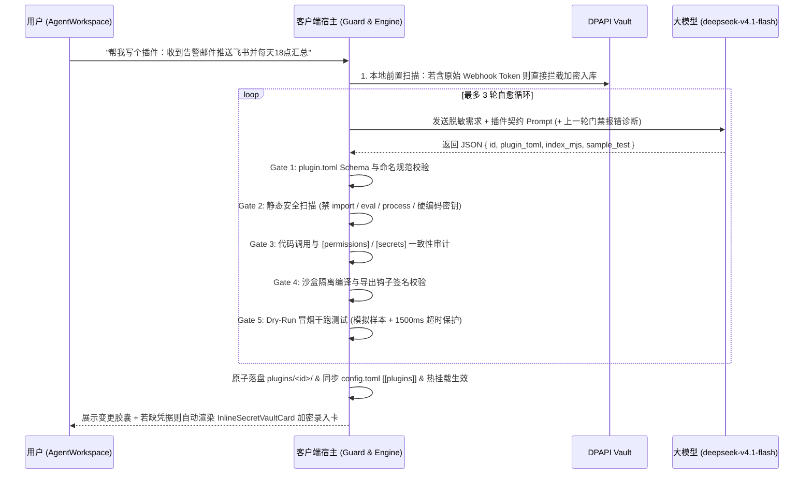

# MailChat 原生插件系统架构与协议规范 (v1)

## 1. 核心设计哲学：为什么采用「免编译双源同构」？

MailChat 现有的三大核心基因决定了插件系统不能照搬传统的重编译方案：
1. **单文件独立桌面分发**（`mailchat.exe` 零终端依赖双击即用，用户电脑上没有 `rustc`、`node_modules` 或打包器）；
2. **声明式配置优先**（所有非敏感业务状态双向同步至人类与 Agent 共读的 `config.toml`）；
3. **DPAPI 隐私凭据绝对隔离**（邮箱授权码与 API Key 永不落入 `config.toml`，永不进入大模型上下文）。

因此，插件系统采用 **「双源同构免构建包（`plugin.toml` + 纯标准 ES2022 `index.mjs`）」**：
- **加载现成插件**：用户或社区将插件文件夹放入 `<app_data_dir>/plugins/<id>/`，客户端扫描通过五道门禁后毫秒级热加载；
- **内置 Agent 自编写插件**：用户在「助手」页提一句自然语言需求，内置模型（如 `deepseek-v4.1-flash`）一次输出约 60~120 行的 `plugin.toml` + `index.mjs`，无需任何外部编译器，经宿主本机五道门禁自检通过后原子落盘并热挂载生效。

---

## 2. 邮件流水线与定时巡检架构图

```mermaid
flowchart TD
    subgraph Inbound["收信同步流水线 (mail.rs -> lib.rs)"]
        IMAP["IMAP 增量拉取 & MIME 解析"] --> GroupRoute["单聊 / 多人全员群聊路由"]
        GroupRoute --> DetRules["确定性规则引擎 (apply_rules)"]
        DetRules -->|未命中固定规则| HookBefore["插件链 Stage 1: onBeforeTriage(mail, ctx)"]
        HookBefore -->|"decision = short_circuit (如验证码极速提取/VIP保送)"| HookAfter
        HookBefore -->|"decision = continue (富化 tags / metadata)"| LLMClassify["内置大模型分拣 (agent::classify)"]
        LLMClassify --> HookAfter["插件链 Stage 2: onAfterTriage(mail, verdict, ctx)"]
        HookAfter -->|"结构化记账入 KV / 飞书 Webhook 盲注入推送 / 摘要增强"| PersistDB["写入 SQLite & 推送前端 mail-updated"]
    end

    subgraph Outbound["发信前置流水线 (send_message)"]
        Compose["用户点击发送草稿"] --> HookSend["插件链 Stage 3: onBeforeSend(draft, ctx)"]
        HookSend -->|"cancel = true (如误发私钥/API Key 阻断)"| RejectUI["阻断发信并向前端提示原因"]
        HookSend -->|"放行 / 追加签名与协议头"| SMTPSend["SMTP 多收件人发送"]
    end

    subgraph BackgroundCron["后台定时巡检心跳 (POLL_SECS 轮询)"]
        Ticker["定时触发器 (interval_secs / daily_at)"] --> HookCron["插件链 Stage 4: onSchedule(tick, ctx)"]
        HookCron -->|"汇总发票台账 / 扫描超时未回 VIP 会话"| NotifyUI["推送桌面/应用内提醒卡片"]
    end
```



---

## 3. 插件包协议规范 (`plugins/<plugin-id>/`)

每个插件是一个独立子目录，仅包含两个文件：

### 3.1 声明式清单 `plugin.toml`

```toml
[plugin]
id = "invoice-ledger-feishu"          # 唯一 kebab-case 标识（与目录名一致）
name = "电子发票台账与飞书推送"
version = "1.0.0"
description = "提取发票金额入账并同步至飞书机器人"
author = "mailchat-official"
source = "prebuilt"                   # "prebuilt"（现成导入） | "agent"（内置助手生成）
priority = 30                         # 数字越小越先执行（默认 100）

[permissions]
hooks = ["onAfterTriage", "onSchedule"]
network = ["open.feishu.cn"]          # 精确 HTTPS 域名白名单（严禁 '*'，默认拦截内网回环防 SSRF）
mail_access = "current"               # "current"（仅当前流经邮件） | "read_recent"（允许只读查询近期会话）
kv_storage = true                     # 是否启用插件独占命名空间 KV（1MB 配额）
llm_access = false                    # 是否允许调用 ctx.llm.complete 复用宿主模型

[secrets.feishu_token]
label = "飞书自定义机器人 Webhook Token"
hint = "由本机 Windows DPAPI 加密存储，插件通过 {{secret:feishu_token}} 盲注入发送"

[config]
min_notify_amount = { default = 0 }   # 可在全局 config.toml [[plugins]] 中由用户或助手覆盖

[schedule]
daily_at = "18:00"                    # 或 interval_secs = 3600
```

### 3.2 免构建脚本 `index.mjs` 与受控宿主 API (`ctx`)

插件运行于禁止 `eval` / `Function` / 外部 `import` / 文件系统与原始套接字的隔离沙盒中，唯一外部通道为宿主注入的只读 `ctx`：

| 能力域 | 方法签名 | 权限门控与安全设计 |
| :--- | :--- | :--- |
| **配置读取** | `ctx.config.<key>` | 只读冻结对象，自动合并 `plugin.toml` 默认值与全局 `config.toml` 覆盖值 |
| **结构化日志** | `ctx.log.info / warn / error(msg, meta?)` | 自动脱敏：若日志意外包含已配置的 Vault 凭据字串，宿主落盘前强制替换为 `[REDACTED]` |
| **独占存储** | `ctx.kv.get / set / delete / listKeys` | 需 `kv_storage = true`；强隔离在 `plugin:<id>:*` 命名空间下，单插件上限 1MB |
| **受控网络与盲注入** | `ctx.http.fetch(url, options)` | 需 `permissions.network` 白名单匹配；支持 URL/Headers/Body 中的 `{{secret:<slot>}}` 宿主侧盲注入 |
| **凭据状态探测** | `ctx.secrets.has(slot)` | 仅返回布尔值（是否已录入），仅限探测本插件声明的 `[secrets.<slot>]`，严禁触碰 `mail_password` 与 `llm_*` |
| **近期邮件巡检** | `ctx.mail.queryRecent(query)` | 需 `mail_access = "read_recent"`，单次最多返回 50 条只读摘要（供 SLA 巡检使用） |
| **复用宿主模型** | `ctx.llm.complete(prompt, opts)` | 需 `llm_access = true`，底层复用 `agent::complete`，插件全程接触不到模型 API Key |

---

## 4. DPAPI 隐私保险箱「宿主盲注入」机制

为了贯彻 MailChat **「密钥绝不进 `config.toml`、绝不进大模型上下文、甚至不暴露给第三方插件 JS 内存」** 的隐私高标准：

1. **命名空间硬隔离**：插件 `<id>` 声明的 `[secrets.<slot>]` 在 `secrets.vault.json` 中统一存储为 `plugin:<id>:<slot>`，经 Windows DPAPI (`CryptProtectData`) 加密。
2. **输入前置拦截**：若用户在「助手」聊天框需求里直接粘贴了带密钥的飞书/钉钉/企微 Webhook URL（如 `https://open.feishu.cn/.../hook/9f8a...`），宿主在本地**发送给大模型之前**立即剥离密钥并直接存入 DPAPI Vault，模型看到的只是 `<INTERCEPTED_INTO_LOCAL_VAULT>`。
3. **发包前双重校验盲替换**：插件在 `index.mjs` 中只需写 `"https://open.feishu.cn/open-apis/bot/v2/hook/{{secret:feishu_token}}"`。宿主收到 `ctx.http.fetch` 请求时：
   - 第一步：先校验目标域名是否在 `permissions.network` 白名单内（防止插件把 `{{secret:feishu_token}}` 发往攻击者服务器 `evil.com` 窃取凭据！）；
   - 第二步：校验通过后，在 Rust 宿主原生 HTTP 客户端内部将占位符替换为真实凭据并发出请求；
   - 第三步：记录审计日志时保留 `<vault:feishu_token>` 掩码。

---

## 5. 内置 AI 助手自编写插件的「五道门禁自愈闭环」



---

## 6. 未来真实接入 MailChat 客户端的逐文件落地蓝图

当确认本套架构并准备正式接入客户端时，与现有代码库的对接边界极其清晰，改动面完全收敛：

| 目标模块 | 改造内容摘要 |
| :--- | :--- |
| `src-tauri/Cargo.toml` | 引入纯 Rust / 轻量内嵌 JS 引擎（推荐 **`boa_engine`** 纯 Rust 零 C 编译器依赖，或 **`rquickjs`** 高性能轻量字节码沙盒），保证 `mailchat.exe` 依然是零外部依赖独立单文件 |
| `src-tauri/src/plugin_host.rs` *(新增)* | 将 `plugin-lab/host/{validator,sandbox,host-engine}` 1:1 实现为 Rust 模块：提供 `PluginRegistry`、内存/CPU 中断配额控制、域名白名单 `reqwest` 盲注入代理 |
| `src-tauri/src/db.rs` | 新增一张轻量表 `plugin_kv (plugin_id TEXT, key TEXT, value TEXT, updated_at INTEGER, PRIMARY KEY(plugin_id, key))` 承载插件独占 KV |
| `src-tauri/src/vault.rs` | 扩展 `statuses()` 支持扫描已安装插件声明的 `plugin:<id>:<slot>` 凭据状态（直接复用现有 DPAPI 加解密与前端 `InlineSecretVaultCard`！） |
| `src-tauri/src/config.rs` | 在 `DeclarativeConfig` 中新增 `#[serde(default)] pub plugins: Vec<PluginSpec>`，与磁盘 `plugins/<id>/plugin.toml` 自动双向对账 |
| `src-tauri/src/mail.rs` & `lib.rs` | 在 `process_pending_with_agent` 前后接入 `onBeforeTriage` / `onAfterTriage`；在 `send_message` 接入 `onBeforeSend`；在后台轮询循环接入 `onSchedule`（保留单插件异常绝不丢信的兜底保护） |
| `src-tauri/src/agent.rs` | 在 `ConfigAgentPlan` 中增加可选 `generated_plugin`，当用户要求定制自动化插件时触发五道门禁自愈闭环并自动热加载 |
| `src/components/Settings.tsx` | 新增「插件」标签页：一键启停插件、查看权限白名单与执行日志、打开 `plugins/` 目录导入现成插件包 |
